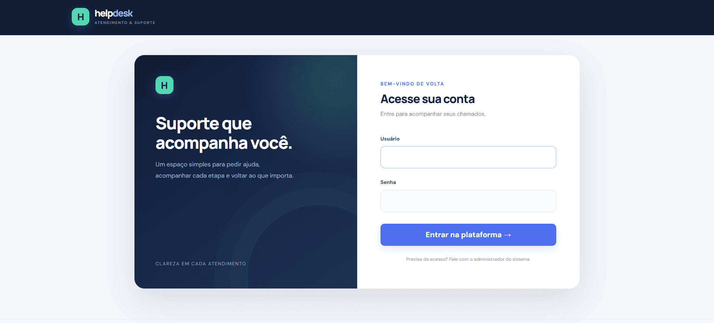
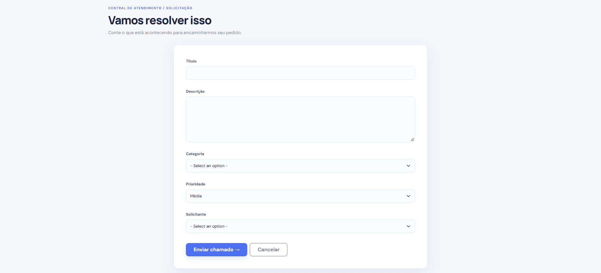

# Helpdesk

Sistema web de atendimento e suporte técnico feito com Django. Permite abrir e acompanhar chamados, organizar o trabalho da equipe por status e consultar artigos de autoatendimento.

## Capturas de tela

### Acesso



### Fila da equipe de suporte


### Chamados


### Abertura de solicitação



> As capturas ficam em `docs/`. Mantenha esses nomes ou atualize os caminhos acima se os arquivos forem renomeados.

## Funcionalidades

- Abertura, edição e acompanhamento de chamados.
- Busca por título, descrição, solicitante ou número do chamado.
- Filtros por status, categoria e prioridade; a equipe de suporte também pode ver os chamados atribuídos a si.
- Resumo da fila por status e paginação dos resultados.
- Fluxo de atendimento com atribuição, escalonamento para N2 e resolução com registro de notas técnicas.
- Acesso aos chamados controlado por perfil: solicitante, suporte N1, suporte N2 e administrador.
- Central de ajuda com busca e filtro por categoria.
- Gerenciamento de artigos pela interface administrativa do Django.

## Tecnologias

- Python 3.13+
- Django 6.1
- SQLite para desenvolvimento local
- Bootstrap 5 e CSS próprio para a interface

## Executar localmente

### Windows (PowerShell)

```powershell
py -m venv .venv
.\.venv\Scripts\Activate.ps1
python -m pip install -r requirements.txt
python manage.py migrate
python manage.py seed_demo
python manage.py runserver
```

Abra <http://127.0.0.1:8000/>. A tela de autenticação está em <http://127.0.0.1:8000/accounts/login/>.

O comando `seed_demo` cria usuários e chamados de demonstração quando necessário. Em ambiente local, os usuários de demonstração usam a senha `demo12345`; não use essa senha fora do desenvolvimento. Para criar uma conta administrativa própria, use `python manage.py createsuperuser`.

## Rotas úteis

| Endereço | Uso |
| --- | --- |
| `/` | Fila de chamados ou chamados do solicitante |
| `/tickets/novo/` | Abrir chamado |
| `/ajuda/` | Central de ajuda |
| `/admin/` | Administração do Django e artigos |
| `/accounts/login/` | Entrar |

## Estrutura do projeto

```text
accounts/     Perfis, grupos e autenticação
config/       Configurações e rotas do Django
knowledge/    Artigos e central de ajuda
static/       CSS da interface
templates/    Layout compartilhado e autenticação
tickets/      Chamados, formulários, fluxo e telas
docs/         Capturas de tela do projeto
```

## Licença

Distribuído sob a licença MIT. Consulte [LICENSE](./LICENSE).
