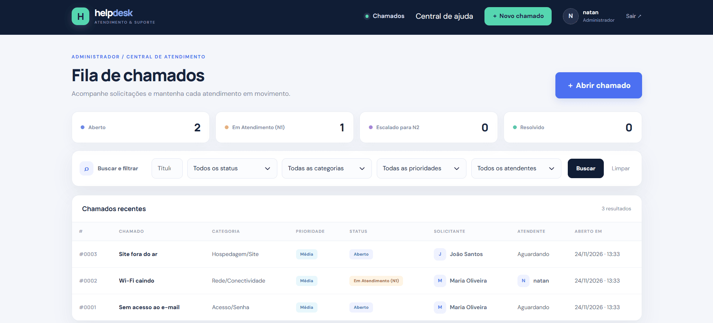
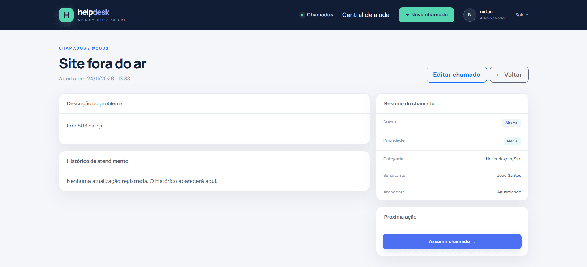

# Helpdesk

Aplicação web de atendimento e suporte técnico construída com Django. O Helpdesk reúne em um só lugar a abertura de solicitações, o trabalho das equipes de suporte e orientações de autoatendimento.

## Proposta

O projeto organiza o atendimento de TI em um fluxo que pode ser acompanhado desde a abertura até a resolução. Em vez de tratar pedidos em conversas dispersas, cada solicitação vira um chamado com responsável, categoria, prioridade, status e histórico.

O sistema atende dois públicos: pessoas que precisam pedir ajuda e profissionais que recebem, assumem, encaminham e resolvem esses pedidos. A central de ajuda complementa esse fluxo com artigos que podem orientar a pessoa antes ou durante a abertura de um chamado.

## O que o sistema faz

- Permite que uma pessoa abra um chamado com título, descrição e categoria.
- Mostra a cada solicitante somente os próprios chamados.
- Dá à equipe de suporte uma fila geral, busca por texto ou número e filtros por status, categoria, prioridade e responsável.
- Resume a fila por status e divide listas longas em páginas.
- Registra o atendimento como uma sequência de transições, com notas técnicas nas ações que exigem diagnóstico ou justificativa.
- Atribui o chamado ao atendente N1 que o assume e permite escaloná-lo para N2.
- Mostra uma central de artigos pesquisável por assunto e categoria.
- Permite administrar artigos e usuários pela área administrativa do Django.

## Fluxo do chamado

```text
Aberto → Em atendimento (N1) → Resolvido
                         └──→ Escalado para N2 → Resolvido
```

Um chamado aberto pode ser assumido pelo suporte N1. Durante o atendimento, N1 pode resolvê-lo ou escalá-lo para N2; o escalonamento e a resolução exigem uma nota técnica. N2 pode resolver chamados escalados. O sistema grava as mudanças de status e suas notas em `TicketNote`, formando o histórico do chamado.

## Perfis de acesso

| Perfil | O que pode fazer |
| --- | --- |
| Solicitante | Abrir chamados, acompanhar os próprios chamados e editar os que ainda estão abertos. |
| Suporte N1 | Consultar a fila, assumir chamados, registrar atendimento, escalar para N2 e resolver. |
| Suporte N2 | Consultar a fila e resolver chamados que chegaram escalados. |
| Administrador | Administrar o sistema e operar o fluxo de suporte. |

Os perfis de suporte são associados a grupos do Django. Usuários sem um grupo de suporte são tratados como solicitantes; superusuários recebem o perfil de administrador.

## Como o código está organizado

O projeto separa configurações gerais, regras de negócio e telas por responsabilidade:

| Caminho | Responsabilidade |
| --- | --- |
| `manage.py` | Atalho para executar os comandos de administração do Django. |
| `config/settings.py` | Aplicativos instalados, middleware, templates, banco e configurações gerais. |
| `config/urls.py` | Conecta as rotas de autenticação, chamados e central de ajuda. |
| `config/wsgi.py` | Expõe a aplicação WSGI usada por servidores de aplicação em produção. |
| `accounts/roles.py` | Resolve o perfil do usuário a partir de superusuário e grupos. |
| `accounts/context_processors.py` | Disponibiliza o perfil e o acesso de suporte aos templates. |
| `tickets/models.py` | Define `Ticket`, `TicketNote` e a regra de visibilidade dos chamados. |
| `tickets/forms.py` | Define formulários diferentes para solicitantes e suporte. |
| `tickets/permissions.py` | Centraliza as regras para visualizar e editar chamados. |
| `tickets/services.py` | Aplica transições permitidas em uma transação, salva as notas e atualiza responsável e datas. |
| `tickets/views.py` | Recebe pedidos HTTP, aplica filtros, chama formulários e serviços e prepara dados para as páginas. |
| `tickets/templates/` | Telas de fila, detalhes e formulários de chamados. |
| `knowledge/models.py` | Define o artigo de ajuda, seus sintomas, solução, categoria e data de atualização. |
| `knowledge/views.py` | Busca, filtra, pagina e exibe artigos para usuários autenticados. |
| `knowledge/templates/` | Telas da central de ajuda e leitura de artigo. |
| `templates/base.html` | Layout compartilhado, navegação, mensagens e rodapé. |
| `static/css/helpdesk.css` | Identidade visual e regras responsivas da interface. |
| `docs/` | Capturas de tela incluídas neste README. |

### Como uma requisição funciona

1. O navegador acessa uma rota definida em `config/urls.py` e nos arquivos `tickets/urls.py` ou `knowledge/urls.py`.
2. A view busca os dados necessários e aplica autenticação e permissões.
3. Formulários validam os dados enviados; alterações no fluxo do chamado passam por `tickets/services.py`.
4. O Django renderiza um template HTML usando o layout comum em `templates/base.html` e os estilos em `static/`.
5. Os modelos representam os dados persistidos. As migrações em cada aplicativo versionam a estrutura das tabelas.

As regras principais ficam no servidor. Por exemplo, a view não decide sozinha se um status pode mudar: ela chama o serviço de fluxo, que confere o status atual, o perfil de quem executa a ação e a presença da nota obrigatória antes de gravar a alteração.

## Capturas de tela

### Acesso


### Fila da equipe de suporte



### Chamados



### Abertura de solicitação


## Tecnologias

- Python 3.13 ou superior.
- Django 6.1.
- SQLite como banco padrão de desenvolvimento.
- Bootstrap 5 e CSS próprio para a interface.
- Templates do Django para renderizar as páginas no servidor.

## Clonar e executar no Windows

### 1. Instale os pré-requisitos

Instale o Git e Python 3.13 ou superior. No instalador do Python, habilite a opção para adicionar o Python ao `PATH`. Confira a instalação no PowerShell:

```powershell
git --version
py --version
```

### 2. Clone o repositório

```powershell
git clone https://github.com/weskerxvi/chamados-n1n2.git
cd chamados-n1n2
```

Se o repositório for privado, o GitHub pedirá autenticação. O diretório criado pelo clone é a pasta de trabalho do projeto.

### 3. Crie um ambiente Python e instale as dependências

No PowerShell, sem precisar ativar o ambiente virtual:

```powershell
py -3.13 -m venv .venv
.\.venv\Scripts\python.exe -m pip install --upgrade pip
.\.venv\Scripts\python.exe -m pip install -r requirements.txt
```

O ambiente virtual mantém as dependências do Helpdesk separadas das de outros projetos no computador.

### 4. Prepare o banco e os usuários

```powershell
.\.venv\Scripts\python.exe manage.py migrate
.\.venv\Scripts\python.exe manage.py seed_demo
```

`migrate` cria as tabelas com base nas migrações versionadas. `seed_demo` cria contas de exemplo e alguns chamados quando os dados correspondentes ainda não existem. Para testar com uma conta administrativa própria, use:

```powershell
.\.venv\Scripts\python.exe manage.py createsuperuser
```

### 5. Inicie o servidor local

```powershell
.\.venv\Scripts\python.exe manage.py runserver
```

Abra <http://127.0.0.1:8000/>. O Django encaminha quem não entrou para <http://127.0.0.1:8000/accounts/login/>. A central de ajuda fica em <http://127.0.0.1:8000/ajuda/> e a administração em <http://127.0.0.1:8000/admin/>.

O comando de demonstração usa a senha `demo12345` para contas que cria. As contas de demonstração são `admin` (administrador), `carlos` (N1), `paula` (N2), `maria` e `joao` (solicitantes). Essa senha serve somente para desenvolvimento. Não use essas contas em uma instalação pública.

## Endereços principais

| Endereço | Uso |
| --- | --- |
| `/` | Fila de suporte ou chamados do solicitante autenticado. |
| `/tickets/novo/` | Formulário para abrir chamado. |
| `/tickets/<id>/` | Detalhes, histórico e ações disponíveis para o chamado. |
| `/ajuda/` | Busca e filtro dos artigos de ajuda. |
| `/ajuda/<id>/` | Leitura de um artigo. |
| `/accounts/login/` | Autenticação. |
| `/admin/` | Administração do Django; usuários de suporte precisam de acesso de staff para entrar. |

## Como cadastrar artigos de ajuda

1. Entre em `/admin/` com um usuário superusuário.
2. Abra **Articles** e escolha **Add**.
3. Preencha título, sintomas (quando a orientação se aplica), solução passo a passo e categoria.
4. Salve. O artigo aparecerá em `/ajuda/` e poderá ser encontrado pela busca e pelo filtro de categoria.

## Publicação na internet

O repositório está configurado para desenvolvimento local. **Não publique a configuração atual diretamente na internet.** Antes de expor o sistema, prepare uma configuração de produção para o provedor escolhido e confira pelo menos os itens abaixo:

1. Defina `DEBUG = False` e carregue `SECRET_KEY` de um segredo configurado no provedor; não publique uma chave secreta no código.
2. Configure `ALLOWED_HOSTS` com o domínio da aplicação e os hosts esperados pelo provedor. Configure também origens confiáveis de CSRF para o domínio HTTPS.
3. Use um banco de dados persistente de produção, normalmente PostgreSQL. O SQLite local não deve ficar em um disco temporário de hospedagem.
4. Configure a pasta de saída de arquivos estáticos (`STATIC_ROOT`) e o modo de servi-los em produção, por exemplo com WhiteNoise ou o serviço de arquivos estáticos do provedor. O `STATICFILES_DIRS` atual aponta para o CSS-fonte durante o desenvolvimento.
5. Instale um servidor WSGI de produção, como Gunicorn, e configure o provedor para iniciar `config.wsgi:application`. `manage.py runserver` é apenas para desenvolvimento.
6. Configure as definições e o serviço de e-mail se o sistema precisar enviar notificações; o projeto ainda não tem um fluxo de envio de e-mails configurado.
7. Faça backup do banco, use HTTPS, crie um superusuário próprio e não execute `seed_demo` em produção.

Depois de preparar as configurações específicas do ambiente, o fluxo usual de publicação é:

```text
Clonar o repositório no provedor
Instalar as dependências de produção
Aplicar migrações: python manage.py migrate
Coletar arquivos estáticos: python manage.py collectstatic --noinput
Iniciar o servidor WSGI usando config.wsgi:application
```

Os comandos exatos, a instalação do Gunicorn, a configuração do banco e a coleta de arquivos precisam corresponder ao provedor escolhido. Este repositório ainda não inclui um arquivo de configuração de deploy nem as dependências de um servidor WSGI; portanto, os passos acima são uma lista de preparação, não um deploy de um clique.

## Licença

Distribuído sob a licença MIT. Consulte [LICENSE](./LICENSE).
